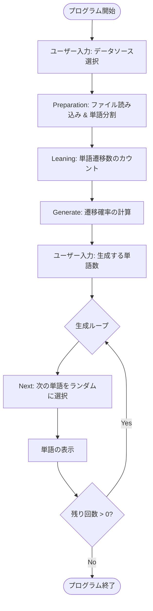

# README

## 実行フロー (Execution Flow)

## 処理の順序 (Linear Process Steps)

このプログラムは、以下の順序で線形に処理を実行します。

1. **初期化 (Initialization)**:
`Main` クラスが起動し、ユーザーに対してデフォルトのデータセットを使用するか、独自のデータセットを使用するかを選択させます。
2. **データの読み込み (Data Loading)**:
`Preparation` クラスが指定されたファイルを読み込みます。テキスト内のピリオド等の処理を行い、テキストを個々の単語の配列へと分割（パース）します。
3. **解析 (Analysis)**:
`Leaning` クラスが単語配列を走査し、ある単語の次にどの単語が何回出現したかをカウントします。これにより、入れ子になったMap構造（`HashMap<現在の単語, HashMap<次の単語, 出現回数>>`）が構築されます。
4. **確率計算 (Probability Calculation)**:
`Generate` クラスが、カウントされた出現回数（生データ）を `Probability` オブジェクト（分子/分母）に変換し、各遷移の確率を計算します。
5. **ユーザー設定 (User Configuration)**:
生成したいテキストの長さ（単語数）や、開始単語（Seed）、生成回数をユーザーに入力させます。
6. **テキスト生成 (Text Generation)**:
* 指定された開始単語（デフォルトあるいはランダム）から処理を開始します。
* 計算された確率とランダムなピボット値に基づいて、次の単語を選択します。
* このプロセスを、指定された単語数に達するか、次の単語が見つからなくなるまで繰り返します。
7. **終了 (Termination)**:
生成されたテキストがコンソールに出力され、プログラムが終了します。
