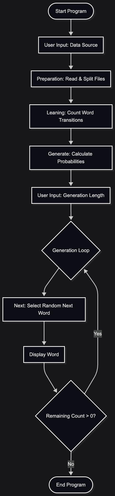

# Markov chain practice java implement

## 目次

- [Markov chain practice java implement](#markov-chain-practice-java-implement)
  - [目次](#目次)
  - [概要](#概要)
  - [プログラム解説](#プログラム解説)
    - [Main.java](#mainjava)
    - [Preparation.java](#preparationjava)
    - [Leaning.java](#leaningjava)
    - [Generate.java](#generatejava)
      - [次単語の出現確率の計算について](#次単語の出現確率の計算について)
    - [Probability.java](#probabilityjava)
  - [Eclipse上でのソースコード一覧](#eclipse上でのソースコード一覧)
  - [Eclipse上での実行例](#eclipse上での実行例)
  - [全体的な工夫点](#全体的な工夫点)
  - [Feature Works](#feature-works)


## 概要

このjavaプロジェクトは任意の英語文字列を学習し、マルコフ連鎖を用いて文を任意の単語数で生成するものです。

## プログラム解説

まず全体は以下のような流れで処理が行われます。以下、ソースコードから一部抜粋しつつ解説を行う。また抜粋の影響でインデントが崩れるが可読性を優先する。

*下記の図はgeminiにソースコードを読ませて生成した図式である。



### Main.java

7行目から22行目において学習用データの決定を行なっている。デフォルトで用意したセットを使うかどうかをユーザーに選択させるプロンプトを行い、Scannerで結果を取得する。ユーザー指定の場合は`,`でパスを区切って入力する。

```java: Main.java
public class Main {
	public static void main(String[] args) {
		// Scannerと全体でのエラーハンドリングのためtry
		try {
			// 学習データのファイルパス指定。デフォルトを使用する場合と自分で用意するかを選択
			ArrayList<String> lst = new ArrayList<String>();
			System.out.printf("do you use default leaning source? (y/n)> ");
            // 省略
        }
```

27行目から38行目において`Preparation`, `Leaning`, `Generate` Classを用いて、入力データの解析を行なっている。解析についての詳細は各Classの解説を参照。

ここでの工夫点として現在の処理についての説明を出力するようにしている。今回のケースでは処理が高速に終了するため、あまり効果はないが学習データの増大や機能増加によってユーザーの待ち時間が増えた際に、処理が進んでいるのかの確認に効果的であると考えたためである。

```java: Main.java
// Preparationにてデータの取得と単語へのパースを行う
var parsed_data = new Preparation(lst.toArray(new String[0]));

System.out.printf("analyzing...\n");
// Leaningにて各単語の出現回数をカウントしてベクトル的に格納
var leaned_data = new Leaning(parsed_data.get_input());
System.out.printf("analyzed\n");

// Generateにて出現回数から次単語の出現確率を各ベクトルに変換
System.out.printf("caluculating...\n");
var caled = new Generate(leaned_data);
System.out.printf("caluculated\n");
```

31行目から51行目にかけては、実際の出力を行っている。生成する単語数をユーザーに入力してもらい、それに基づいて`Gemerate` Classのメソッドである`loopShow()`を用いて指定回数分の生成と表示を行っている。

```java: Main.java
// 何単語分生成するかを質問
System.out.printf("\nhow long do you want to generate?>");
var i = sc.nextInt();
// 入力はこれ以降ないのでここでclose()
sc.close();

// 出力のセパレータ
System.out.printf("\n");

// スタートはTheで固定
// iは生成する単語数
caled.loopShow("The", i);
```

54行目以降はエラーハンドリングとして上記の処理で発生した例外をすべてcatchしてそのままエラーとして表示している。今回はリトライで成功すするような処理はないため、そのまま`Exit(1)`として終了する。

```java: Main.java
catch (Exception e) 
```

56行目以降ではデフォルトの学習データのパスの定義などを行っている。現在は私の環境でしか動作しないため再現性を高めるためにはもっと汎用的なパスの生成を行う必要がある。

```java: Main.java
static String getTestDataSetPath() 
```

### Preparation.java

パスから実際のファイルの内容の取得と、実際の解析前の文字列の単語分割を行う。

Preparationのコンストラクタ。`get_input()`と`get_some_input()`をまとめて実行する実質的なラッパー関数。

```java: Preparation.java
public Preparation(String[] p) throws Exception {
    try {
        this.input = this.Parse(this.get_some_input(p));
        System.out.printf("loaded %d words\n\n", this.input.length);
    } catch (Exception e) {
        throw e;
    }
}
```

1つのファイルの内容を取得する関数。ファイルの存在確認も行う。

```java: Preparation.java
String get_input(String path) throws Exception {
    var p = Paths.get(path);

    // ファイルの存在確認
    if (!Files.isRegularFile(p)) {
        throw new InvalidInput(String.format("invalid input: %s", p));
    }

    // Io操作に失敗する可能性があるため
    try {
        return Files.readString(p).replace(".", "");
    } catch (Exception e) {
        throw e;
    }
}
```

`get_input()`を用いて、複数のファイルをパスのリストから取得する関数。これにより簡単に複数のファイルから学習を行える。

```java
String get_some_input(String[] pathes) throws Exception {
    String res = new String();
    for (var p : pathes) {
        res += get_input(p);
    }

    return res;
}
```

シンプルにStringのメソッドでスペース区切りにしてパースを行う関数。日本語対応などを行うならばらここで文法的な解析を行うなど、モジュール性を意識した。

```java
String[] Parse(String input) {
    return input.split(" ");
}
```

### Leaning.java

`HashMap<現在の単語, HashMap<次の単語, 出現回数>>`となるようにカウントを行った。

```java: Leaning.java
HashMap<String, HashMap<String, Integer>> WordsMap;
```

`collect_analyzer()`関数は単語A(`words[i]`)に対して次の単語(`words[i+1]`)を登録,カウントしていく関数である。`.merge()`を用いることで、容易に初期値とインクリメントを実現できる。

```java: Leaning.java
void collect_analyzer(String[] words) {
    for (int i = 0; i < words.length - 1; i++) {
        this.WordsMap.computeIfAbsent(words[i], k -> new HashMap<>()).merge(words[i + 1].trim(), 1, Integer::sum);
    }
}
```

### Generate.java

上記の`HashMap<現在の単語, HashMap<次の単語, 出現回数>>`を出現回数と母数より確率として計算する処理を行う。分数を扱う`Probability` Classについてはそちらの解説を参照。小数点数を用いるとバグの温床となるため、今回は独自に分数として扱えるようなClassを実装した。

```java
HashMap<String, HashMap<String, Probability>> ProbabilityMap;
```

#### 次単語の出現確率の計算について
まず、現在の単語をA, 次に来たことのある単語とその回数のペアをBとする。BのペアはAに紐付いてベクトルのように保存されている。
そこからAにひも付いたBの単語を総数(重複含む)を数えて、それが次の単語の確率の母数となる。その中で各単語が何%の確率で来るかが回数として保存されているため、Probabilityを用いて、分数として変換する。

具体例として`jumps`の次の単語として記録されたのは`over`, `over`, `out`であった。この際、母数は3, `over`の確率は2, `out`の確率は1である。それらは2/3, 1/3として`Generate` Classの`ProbabilityMap`として変換される。

### Probability.java

分母と分子をメンバー変数として保持することで、分数のように確率を保存できるようになっている。

```java: Probability.java
public class Probability {
    // 分子
    long num;
    // 分母
    long den;
}
```

## Eclipse上でのソースコード一覧

## Eclipse上での実行例

## 全体的な工夫点

- 処理のレイヤーを細かく分けることで今後の変更を行いやすくなった
    - 例えば単語の分割方法を変更する際には`Preparation.java`の処理変更すれば問題なく更新可能
- データ構造に`HashMap`を用いることで高速な処理を行えるようにした

## Feature Works

- 確率を計算する単語数の増加
- 日本語などの多言語対応
- 全体的にOOPらしくない、FP寄りな記述になっている