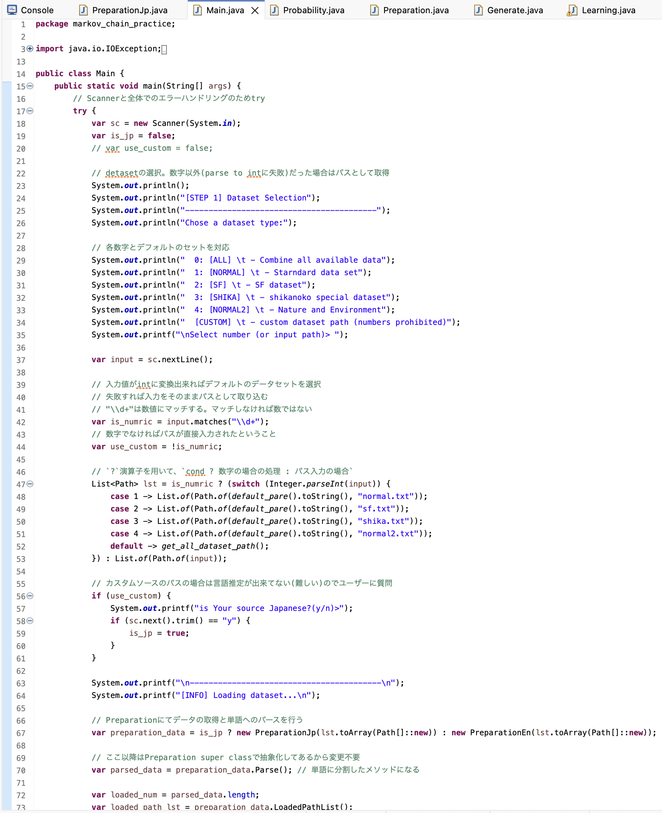
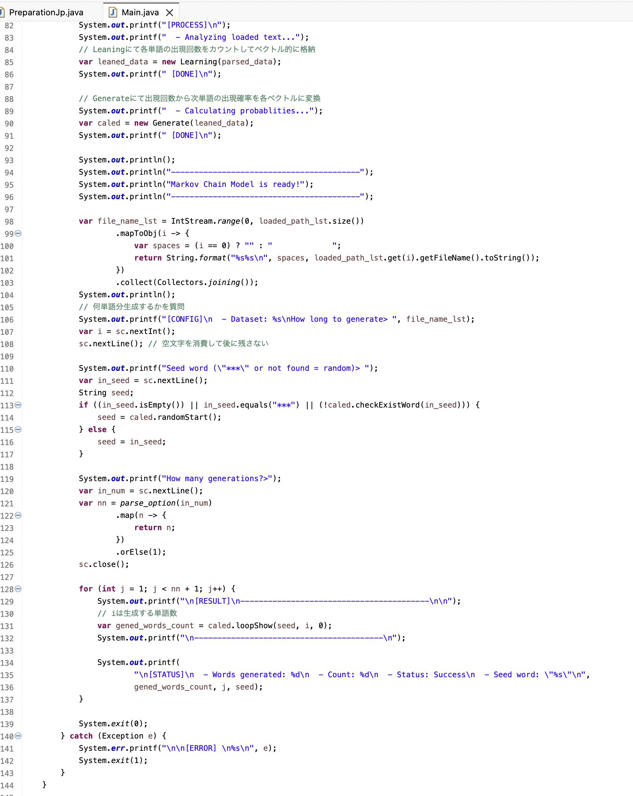
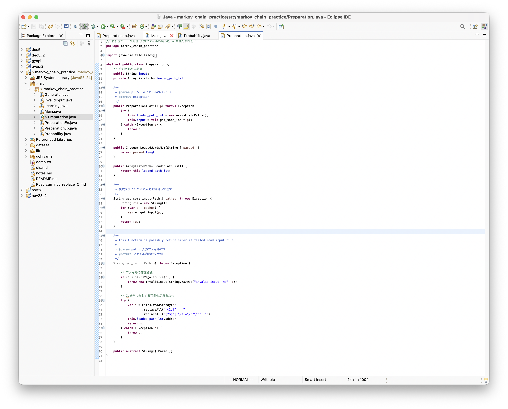
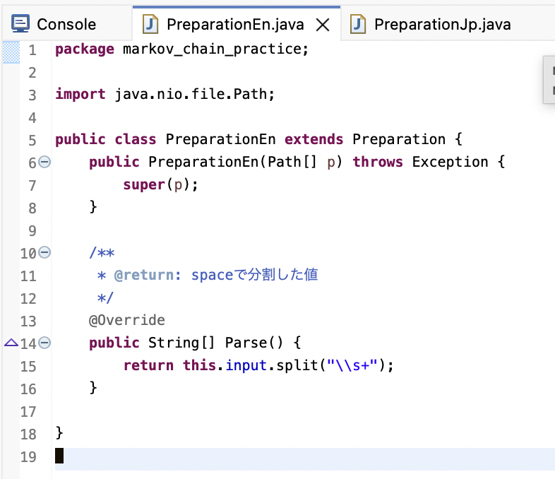
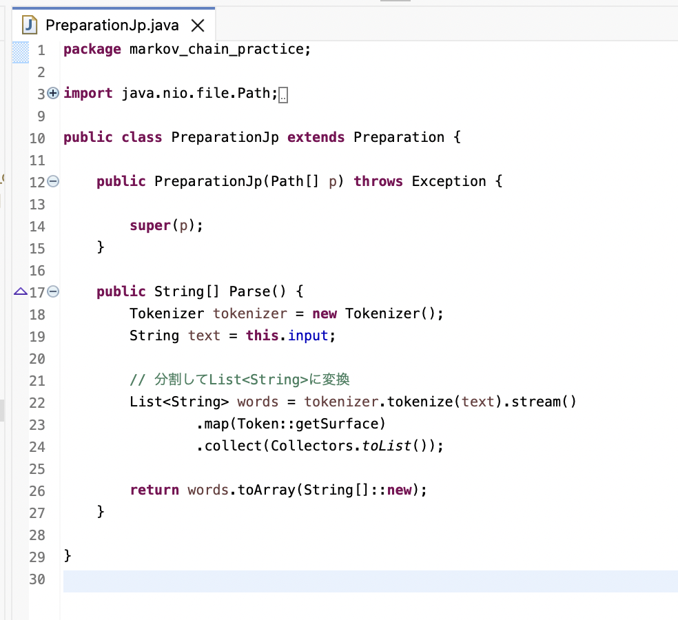
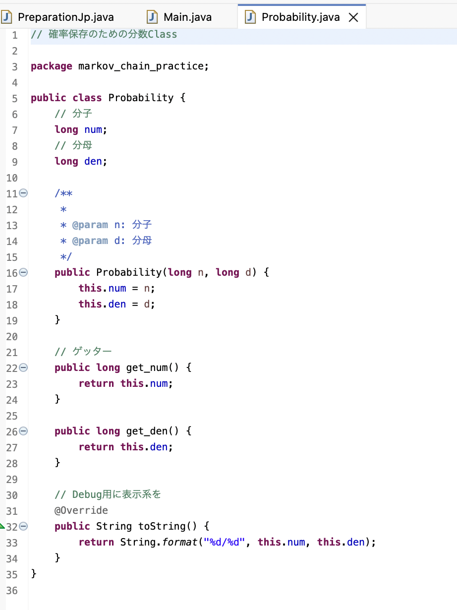
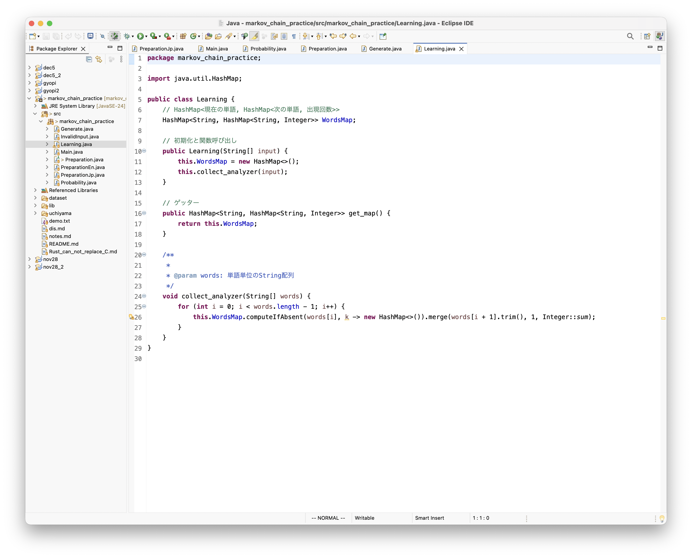
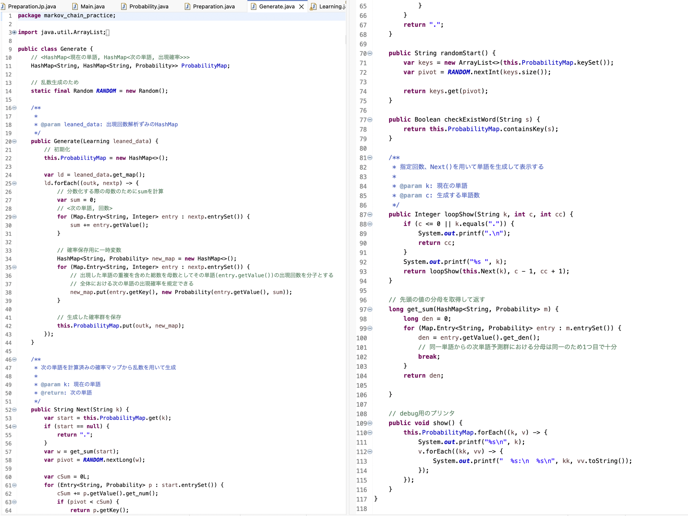
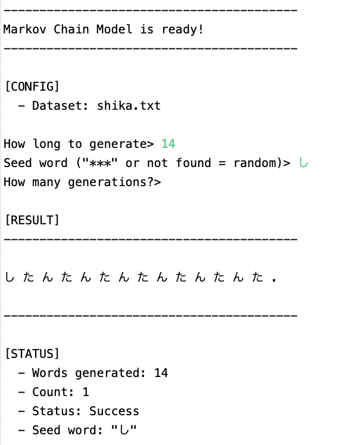
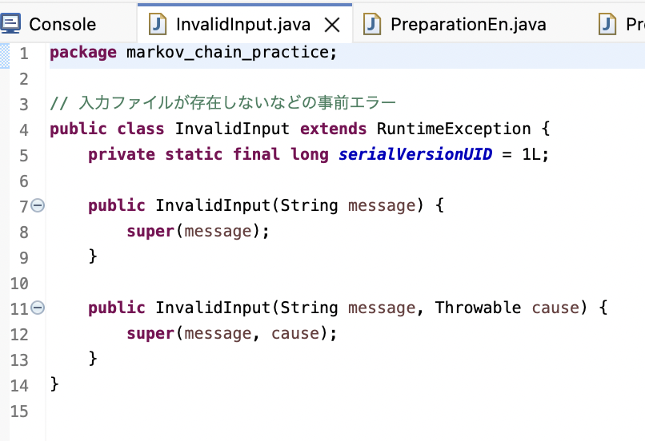

# 自由制作課題（グループ）

## リーダー: 内山 航平(25A4111026), 今 蒼月(25A4111068)

## チーム: 亀扇(kameougi)

---

## 目次

<div class="toc">

- [1. Main.java ソースコード(内山 担当)](#1-mainjava-ソースコード内山-担当)
  - [1.1. メインロジック](#11-メインロジック)
  - [1.2. ロジック図解](#12-ロジック図解)
- [2. Preparation.java (今/内山 担当)](#2-preparationjava-今内山-担当)
  - [2.1. Preparationを継承した英語クラス(内山)](#21-preparationを継承した英語クラス内山)
  - [2.2. Preparationを継承した日本語クラス(今)](#22-preparationを継承した日本語クラス今)
- [3. Probability.java (内山 担当)](#3-probabilityjava-内山-担当)
- [4. Learning.java (内山 担当)](#4-learningjava-内山-担当)
  - [4.1. HashMapを用いた単語予測](#41-hashmapを用いた単語予測)
- [5. Generate.java (内山 担当)](#5-generatejava-内山-担当)
  - [5.1. 再帰関数を用いたリアルタイム出力](#51-再帰関数を用いたリアルタイム出力)
  - [5.2. Generate 結果](#52-generate-結果)
- [6. InvalidInput.java](#6-invalidinputjava)
- [7. ソースコードについて](#7-ソースコードについて)

</div>

---

## 1. Main.java ソースコード(内山 担当)

<div class="columns">
<div>



</div>

<div>



</div>
</div>

---

### 1.1. ソースマップ

```bash
.
├── dataset
│   ├── normal.txt
│   ├── normal2.txt
│   ├── sf.txt
│   └── shika.txt
├── lib
│   ├── kuromoji-core-0.9.0.jar
│   └── kuromoji-ipadic-0.9.0.jar
├── notes.md
├── README.md
└── src
    └── markov_chain_practice
        ├── Generate.java
        ├── InvalidInput.java
        ├── Learning.jav
        ├── Main.java
        ├── Preparation.java
        ├── PreparationEn.java
        ├── PreparationJp.java
        └── Probability.java
```

---

### 1.2. メインロジック

- 主に`Preparation`,`Leaning`,`Generate`を用いてクラスにデータを変換していく
- それぞれのクラスは単一の責任を持つように設計し、処理の差し替えを容易化
- 全体的にCUIでも読みやすいように空行を用いたり`---`などの記号で可読性を向上

---

### 1.2. ロジック図解


---

## 2. Preparation.java (今/内山 担当)

<div class="columns">

<div>



</div>

<div>

### 入力データの下準備

パスからファイル内容の取得と、正規表現を用いた不要な空白や空行の除去、および単語分割を行う。

</div>

</div>

---

### 2.1. Preparationを継承した英語クラス(内山)

<div class="columns">

<div>



</div>

<div>

- `Parse()`メソッドをオーバーライドして英語の用のパースを(スペース分割)
- それ以外の処理はすべて親クラスに依存

</div>

</div>

---

### 2.2. Preparationを継承した日本語クラス(今)

<div class="columns">

<div>



</div>

<div>

- `Parse()`メソッドをオーバーライドすることで日本語特有の単語分割に処理を置き換え
- それ以外の処理はすべて親クラスに依存
- Kkuromoji libを利用することで意味的な日本語の単語分割を実現

</div>

</div>

---

## 3. Probability.java (内山 担当)

<div class="columns">

<div>



</div>

<div>

- 確率情報を分数として保持するためのクラス
- 小数点数で保持すると精度の問題で厳密でなくなるため、分数として保持することに

</div>

</div>

--- 

## 4. Learning.java (内山 担当)

<div class="columns">

<div>



</div>

<div>

### 4.1. HashMapを用いた単語予測

- `HashMap<現在の単語, HashMap<次の単語, 出現回数>>`となるようにカウントを行う
- メソッドを用いることで単語の出現確率演算をシンプルに記述

</div>
</div>

--- 

## 5. Generate.java (内山 担当)

<div class="columns">
<div>



</div>

<div>

### 5.1. 再帰関数を用いたリアルタイム出力

- 再帰しながら常に出力を行うことでリアルタイムに出力を行う

</div>
</div>

--- 

### 5.2. Generate 結果

<div class="columns">



</div>

---

## 6. InvalidInput.java

<div class="columns">

<div>



</div>

<div>
入力エラーなどの定義。
</div>

</div>

---

## 7. ソースコードについて

現在githubのprivate repositoryにソースコード全体がアップロードされています。
Discord(ulibo_4) or uliboulibo@gmail.comにgithubアカウントのidと共にご連絡頂ければ、こちらでrepositoryに招待し、ソースコードを閲覧できるようにいたします。

