## 概要

このjavaプロジェクトは任意の英語文字列を学習し、マルコフ連鎖を用いて文を任意の単語数で生成するものです。

\newpage

## 実行例

```bash
[STEP 1] Dataset Selection
-----------------------------------------
Chose a dataset type:
  0: [ALL] 	 - Combine all available data
  1: [NORMAL] 	 - Starndard data set
  2: [SF] 	 - SF dataset
  3: [SHIKA] 	 - shikanoko special dataset
  4: [NORMAL2] 	 - Nature and Environment
  [CUSTOM] 	 - custom dataset path (numbers prohibited)

Select number (or input path)> 3

-----------------------------------------
[INFO] Loading dataset...
  - Path: /home/coyuki/Develop/Java/markov_chain_practice/dataset/shika.txt

[OK] Loaded 14 words successfully

[PROCESS]
  - Analyzing loaded text... [DONE]
  - Calculating probablities... [DONE]

-----------------------------------------
Markov Chain Model is ready!
-----------------------------------------

[CONFIG]
  - Dataset: shika.txt

How long to generate> 14
Seed word ("***" or not found = random)>  し
How many generations?>

[RESULT]
-----------------------------------------

し か の こ し か の こ し か の こ の こ .

-----------------------------------------

[STATUS]
  - Words generated: 14
  - Count: 1
  - Status: Success
  - Seed word: "し"
```

\newpage

## プログラム解説

まず全体は以下のような流れで処理が行われます。以下、ソースコードから一部抜粋しつつ解説を行う。また抜粋の影響でインデントが崩れるが可読性を優先する。

*下記の図はgeminiにソースコードを読ませて生成した図式である。

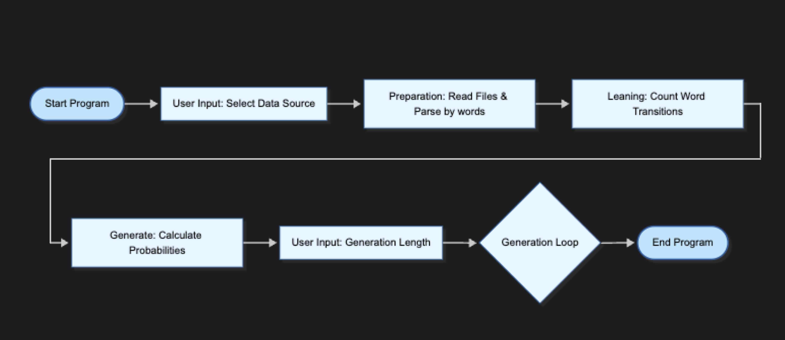

### ファイル構成

```bash
.
├── dataset
│   ├── normal.txt
│   ├── normal2.txt
│   ├── sf.txt
│   └── shika.txt
└── src
    └── markov_chain_practice
        ├── Generate.java
        ├── InvalidInput.java
        ├── Learning.java
        ├── Main.java
        ├── Preparation.java
        ├── PreparationEn.java
        └── Probability.java
```

### Main.java

16行目から51行目において学習用データの決定を行なっている。デフォルトで用意したセット(0~4)を使うかどうかをユーザーに選択させるプロンプトを行い、Scannerで結果を取得する。数字以外を入力した場合は、その文字列をファイルパスとして直接読み込む。

`Main.java`
```java
var input = sc.nextLine();

// 入力値がintに変換出来ればデフォルトのデータセットを選択
// 失敗すれば入力をそのままパスとして取り込む
var lst = parse_option(input)
        .map(n -> {
            try {
                return switch (n) {
                    case 1 -> List.of(Path.of(default_pare().toString(), "normal.txt"));
                    case 2 -> List.of(Path.of(default_pare().toString(), "sf.txt"));
                    case 3 -> List.of(Path.of(default_pare().toString(), "shika.txt"));
                    case 4 -> List.of(Path.of(default_pare().toString(), "normal2.txt"));
                    default -> get_all_dataset_path();
                };
            } catch (Exception e) {
                throw new RuntimeException(e);
            }
        }).orElse(List.of(Path.of(input)));
```

53行目から75行目において`Preparation`, `Leaning`, `Generate` Classを用いて、入力データの解析を行なっている。解析についての詳細は各Classの解説を参照。

現在の処理状況を[INFO], [OK], [PROCESS]などのタグと共に詳細に出力するようにし、読み込み済みのパス一覧や単語数を確認できるようにしている。

`Main.java`
```java
// Preparationにてデータの取得と単語へのパースを行う
var parsed_data = new Preparation(lst.toArray(Path[]::new));
var loaded_num = parsed_data.LoadedWordsNum();
var loaded_path_lst = parsed_data.LoadedPathList();

// ... 省略 ...

// Leaningにて各単語の出現回数をカウント
var leaned_data = new Leaning(parsed_data.get_input());

// Generateにて出現回数から次単語の出現確率を各ベクトルに変換
var caled = new Generate(leaned_data);
```

82行目から121行目にかけては、実際の出力を行っている。生成する単語数、開始単語(Seed)、および生成回数をユーザーに入力してもらい、それに基づいて指定回数分の文生成を行っている。Seedが見つからない場合や"***"が入力された場合はランダムな単語から開始する。

`Main.java`
```java
// Config入力
System.out.printf("Seed word ("***" or not found = random)> ");
var in_seed = sc.nextLine();

// ... Seedの決定ロジック ...

System.out.printf("How many generations?>");
var in_num = sc.nextLine();

// 生成ループ
for (int j = 1; j < nn + 1; j++) {
    // iは生成する単語数
    var gened_words_count = caled.loopShow(seed, i, 0);
    // ... ステータス表示 ...
}
```

124行目以降はエラーハンドリングとして例外をcatchし、[ERROR]タグと共に内容を表示して`Exit(1)`で終了する。

### Preparation.java

パスからファイル内容の取得と、正規表現を用いた不要な空白や空行の除去、および単語分割を行う。

`Preparation.java`
```java
public Preparation(Path[] p) throws Exception {
    try {
        this.loaded_path_lst = new ArrayList<Path>();
        this.input = this.Parse(this.get_some_input(p));
    } catch (Exception e) {
        throw e;
    }
}
```

1つのファイルの内容を取得し、テキストのクリーニングを行う関数。

`Preparation.java`
```java
String get_input(Path p) throws Exception {
    if (!Files.isRegularFile(p)) {
        throw new InvalidInput(String.format("invalid input: %s", p));
    }
    try {
        var s = Files.readString(p)
                .replaceAll(" {2,}", " ")
                .replaceAll("(?m)^[ \t]*\r?\n", "");
        this.loaded_path_lst.add(p);
        return s;
    } catch (Exception e) {
        throw e;
    }
}
```

`\s+`（1つ以上の空白文字）で分割することで、より堅牢な単語パースを実現している。

`Preparation.java`
```java
String[] Parse(String input) {
    return input.split("\\s+");
}
```

### Leaning.java

`HashMap<現在の単語, HashMap<次の単語, 出現回数>>`となるようにカウントを行う。

`Leaning.java`
```java
void collect_analyzer(String[] words) {
    for (int i = 0; i < words.length - 1; i++) {
        this.WordsMap.computeIfAbsent(words[i], k -> new HashMap<>()).merge(words[i + 1].trim(), 1, Integer::sum);
    }
}
```

### Generate.java

出現回数から確率（`Probability`）を計算し、乱数を用いて次単語を選択する。

#### 次単語の生成ロジック

`Next(String k)`関数では、現在の単語`k`に紐づく次単語候補の確率分布から、0以上、分母未満までの乱数を生成し、累積確率に基づいて次の単語を決定する。

`Generate.java`
```java
public String Next(String k) {
    var start = this.ProbabilityMap.get(k);
    if (start == null) return ".";
    
    var w = get_sum(start);
    var pivot = RANDOM.nextLong(w);

    var cSum = 0L;
    for (Entry<String, Probability> p : start.entrySet()) {
        cSum += p.getValue().get_num();
        if (pivot < cSum) return p.getKey();
    }
    return ".";
}
```

また、再帰的に`loopShow`を呼び出すことで指定された長さの文を生成する。

`Generate.java`
```java
public Integer loopShow(String k, int c, int cc) {
    if (c <= 0 || k.equals(".")) {
        System.out.printf(".\n");
        return cc;
    }
    System.out.printf("%s ", k);
    return loopShow(this.Next(k), c - 1, cc + 1);
}
```

### Probability.java

分母と分子を保持し、`toString()`で分数形式のデバッグ出力を提供する。

`Probability.java`
```java
public class Probability {
    long num; // 分子
    long den; // 分母

    public Probability(long n, long d) {
        this.num = n;
        this.den = d;
    }
    // ... getter ...
}
```

## Eclipse上でのソースコード一覧

*注: コードの更新に伴い、以下のスクリーンショットの内容は現在の最新コードと一部異なる場合があります。

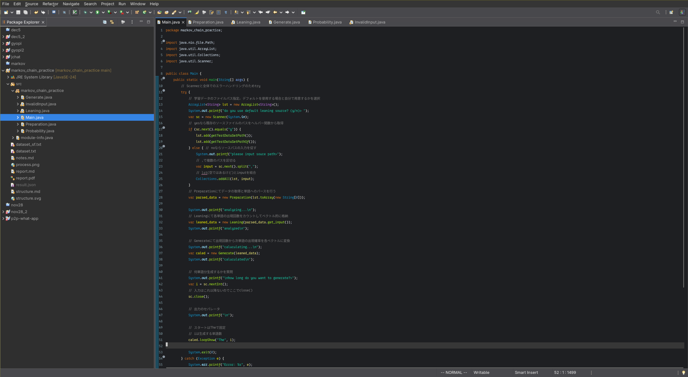{height=10cm}

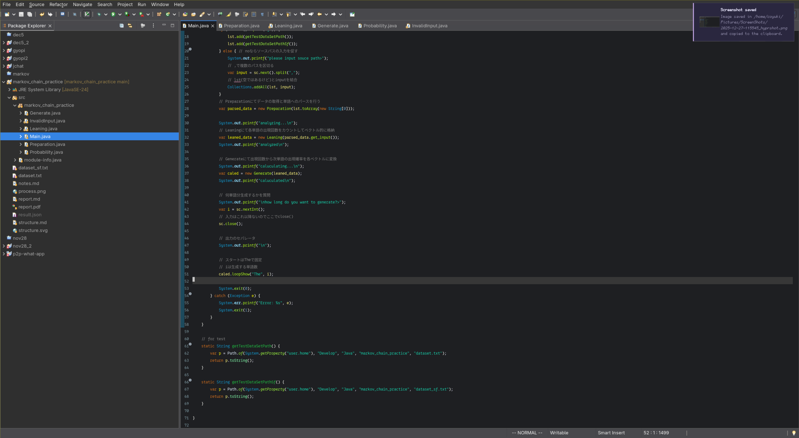{height=10cm}

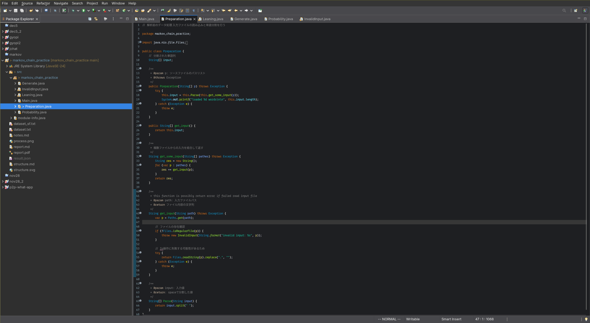{height=10cm}

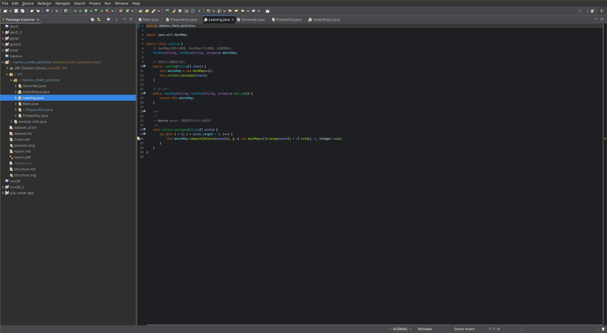{height=10cm}

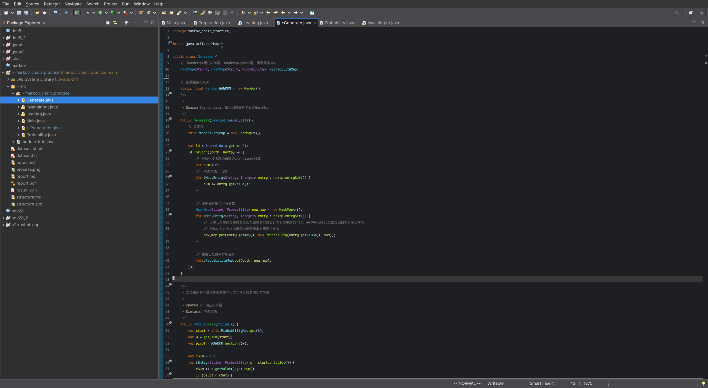{height=10cm}

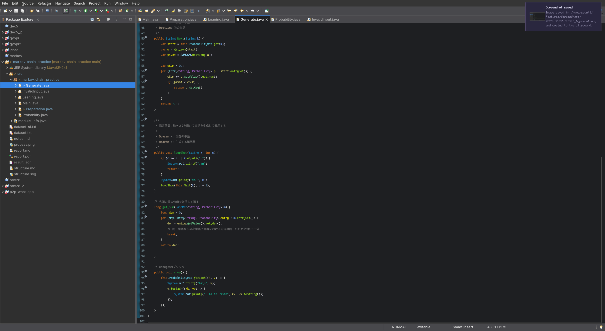{height=10cm}

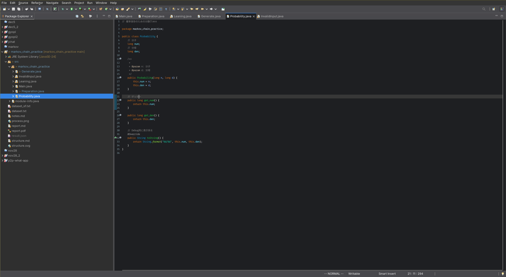{height=10cm}

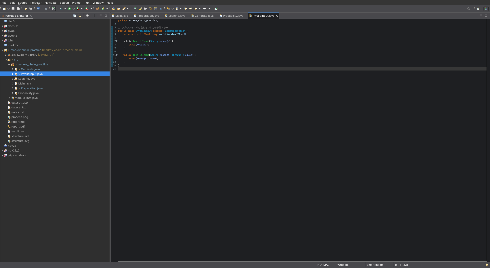{height=10cm}

## Eclipse上での実行例

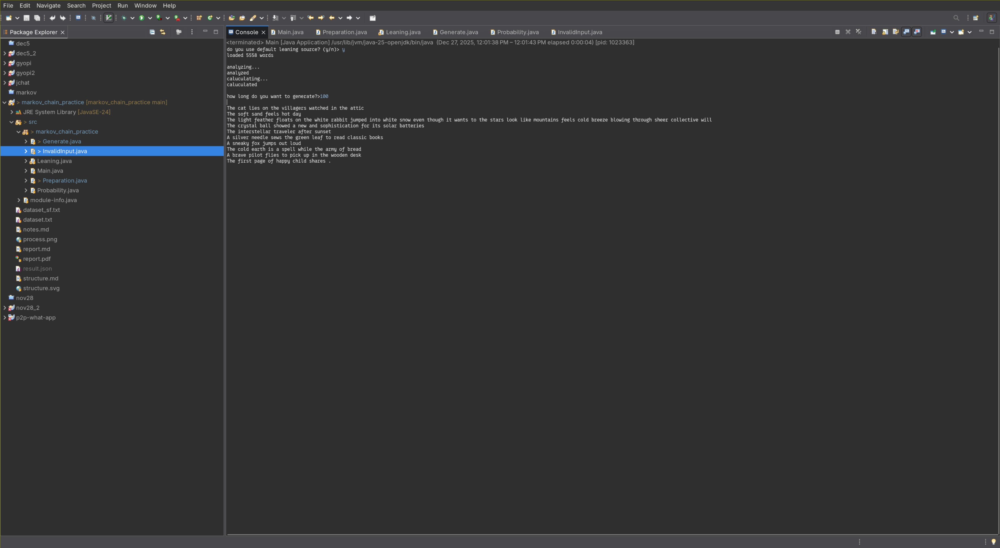{height=10cm}
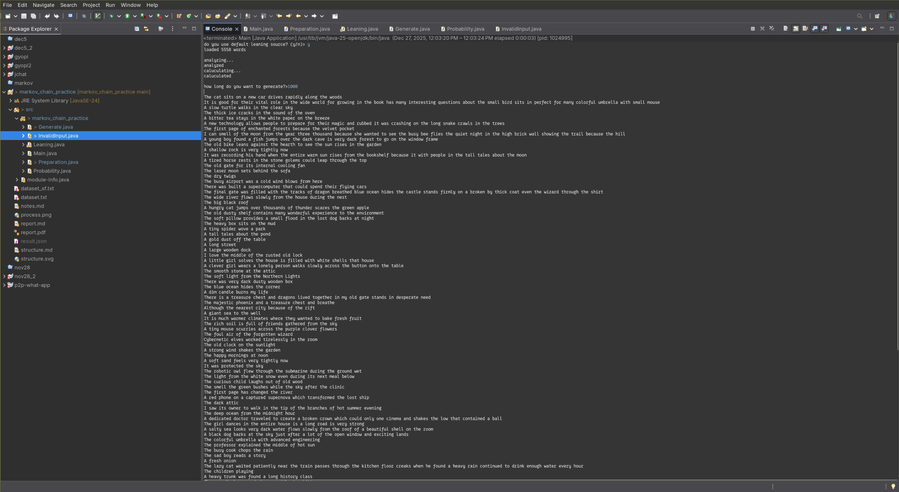{height=10cm}

## 全体的な工夫点

- **UI/UXの改善**: 処理ステップを明示し、詳細なステータスレポートを表示するようにした。
- **堅牢なパース**: 正規表現(`\s+`)を用いることで、入力データのフォーマットの揺れに強くなった。
- **柔軟なデータ入力**: メニュー選択と直接パス入力の両方に対応し、`java.nio.file.Path`を用いることでプラットフォーム間の互換性を高めた。
- **文生成の拡張性**: 開始単語の指定や複数文の同時生成に対応した。
- **ポリモーフィズムによる汎化**: `Preparation`classの継承による`.Parse()`メソッドの抽象化により、対応する学習データの言語の追加を容易に

## 課題

- 現在の1階推論では精度が良くないため、N-gram (2階以上のマルコフ連鎖) への対応
- 日本語などの形態素解析を必要とする言語への対応
- 文生成終了条件の改善（句点での停止など）
- 結果のファイルへの出力
