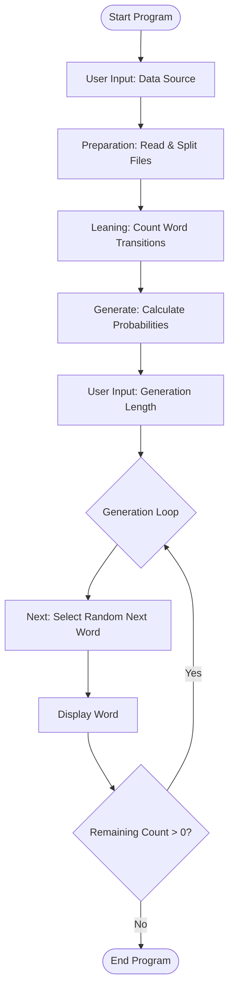

## Execution Flow

## Linear Process Steps

1.  **Initialization**: `Main` starts and asks the user whether to use default datasets or custom ones.
2.  **Data Loading**: `Preparation` reads the specified files, removes periods, and splits the text into an array of individual words.
3.  **Analysis**: `Leaning` iterates through the words, building a nested Map that stores how many times each word is followed by another specific word.
4.  **Probability Calculation**: `Generate` converts those raw counts into `Probability` objects (numerator/denominator) for each possible transition.
5.  **User Configuration**: The user is prompted for the desired length of the generated text.
6.  **Text Generation**:
    *   Starting with the word "The", the system looks up possible next words.
    *   It picks one based on the calculated probabilities using a random pivot.
    *   The process repeats until the requested length is reached or no next word is found.
7.  **Termination**: The generated text is printed to the console and the program exits.